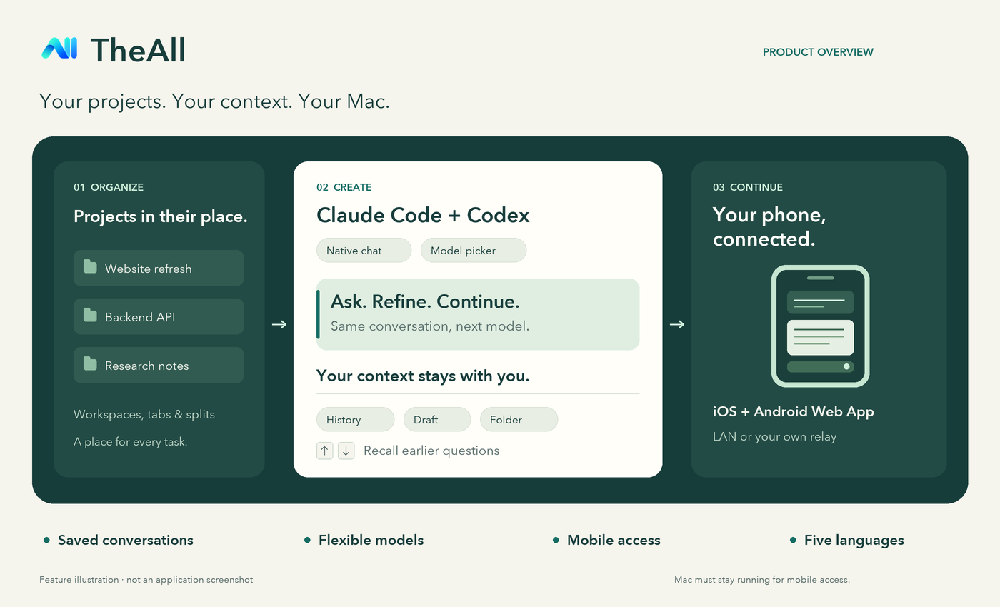

<p align="center">
  
</p>

<h1 align="center">TheAll</h1>
<p align="center"><strong>把 Claude Code 和 Codex，放进同一个 macOS 工作台。</strong><br />项目、AI 对话和模型集中管理。离开电脑，也能在手机上继续。</p>

<p align="center">
  <a href="https://github.com/AbadOrangeCat/TheALL/releases/tag/v0.1.3"></a>
  
  
  
</p>

<p align="center">
  <a href="https://github.com/AbadOrangeCat/TheALL/releases/tag/v0.1.3"><strong>下载 Mac 版</strong></a> ·
  <a href="https://abadorangecat.github.io/TheALL/">项目主页</a> ·
  <a href="docs/mobile-access.md">手机连接</a> ·
  <a href="README.md">English</a>
</p>


<p align="center"><sub>产品功能示意图，非应用截图。</sub></p>

## 保留上下文，让 AI 编程更顺手

**TheAll 是面向 Claude Code 和 OpenAI Codex 的原生 macOS AI 编程工作台。** 它为命令行 Agent 提供图形化聊天界面，将工作区、标签页、分屏、聊天记录和模型选择整合在一起。使用自己的 API 连接，选定项目文件夹，即可开始。

| 你想做的事 | TheAll 如何帮助你 |
| --- | --- |
| **有序管理项目** | 工作区、标签页和分屏；工作区根据首次提问自动命名。 |
| **换模型，保留对话** | 下拉选择模型，保留聊天历史和未发送草稿；支持官方 API 与兼容的自定义 Base URL。 |
| **接着上次继续** | 恢复已保存的对话、工作目录、模型和桌面草稿；↑ / ↓ 可调取之前发送的问题。 |
| **清楚阅读回答** | 提问使用独立颜色，每轮对话有分界线；完成后的思考与进度自动折叠，可随时跳到最新消息。 |
| **在手机上继续** | iOS / Android Web App 支持查看历史、回复、新建对话和停止 Mac 上的任务。 |
| **使用熟悉的语言** | 桌面和手机支持简体中文、English、Français、日本語和한국어。 |

API 连接通过 macOS Keychain 保存。聊天记录保存在 Mac 上，对话会发送到你配置的 AI 服务地址。TheAll 使用 SwiftUI、AppKit 和 Ghostty 终端引擎。

## 开始使用

**运行要求：** macOS 14 及以上、Apple Silicon 芯片的 Mac、可用的 API 连接，以及对应提供商的 [Claude Code CLI](https://code.claude.com/docs/en/setup) 或 [Codex CLI](https://developers.openai.com/codex/cli)。CLI 需要单独安装。

1. 下载 [v0.1.3 DMG](https://github.com/AbadOrangeCat/TheALL/releases/download/v0.1.3/TheAll-0.1.3-macos-arm64.dmg) 或 [ZIP](https://github.com/AbadOrangeCat/TheALL/releases/download/v0.1.3/TheAll-0.1.3-macos-arm64.zip)，将 **TheAll.app** 移到「应用程序」。
2. 打开 TheAll，创建工作区，选择工作文件夹和 **Claude / OpenAI**。
3. 输入 API Key，需要时填写自定义 Base URL；之后的对话可复用已保存的连接。
4. 选择模型，发送第一个问题。工作目录与模型下拉框始终位于输入框旁。

**本版安装说明：** v0.1.3 使用本地开发证书签名，**尚未经过 Apple 公证**。macOS 可能阻止首次打开；核对下载并确认信任后，可按 [Apple 官方说明](https://support.apple.com/en-us/102445)，使用系统提供的「系统设置 → 隐私与安全性 → 仍要打开」。请保留系统安全保护。本版提供 [SHA-256 校验文件](https://github.com/AbadOrangeCat/TheALL/releases/download/v0.1.3/SHA256SUMS.txt)，仅包含 arm64 构建，暂未配置自动更新。

**执行方式：** 编程 Agent 的工具操作会自动执行，包括修改和删除文件、安装依赖及 Git 推送。请选用你准备让 Agent 操作的项目与 API 连接；需要用户回答的问题仍会暂停等待输入。

## 手机连上你的 Mac

TheAll Mobile 是可添加到主屏幕的 Web App，适用于 **iPhone、iPad 和 Android**。Agent 继续在 Mac 上运行，手机控制同一份对话。

| 连接方式 | 如何设置 |
| --- | --- |
| **同一 Wi-Fi / 局域网** | Mac 提供 HTTPS 服务。在手机安装 Mac 导出的公开 CA 证书，再扫描配对二维码；无需服务器或域名。 |
| **外出使用** | 在自己的服务器和域名部署仓库提供的中继。Mac 主动通过 WSS 连接，手机使用 HTTPS；无需额外 VPN App 或路由器端口转发。 |

配对时可选择全部或指定工作区，以及**仅查看**或**查看与操作**权限；可随时在 Mac 撤销设备。API Key 不会发送给手机。Mac 必须保持运行且未休眠；自建中继能够读取转发的流量，应部署在自己信任的服务器上。项目不提供已托管的公网中继。

[手机连接指南](docs/mobile-access.md) · [中继部署说明](mobile-relay/README.md)

## 顺手的快捷键

| 按键 | 操作 |
| --- | --- |
| **⌘ Return** | 发送当前消息。 |
| **Return** | 输入换行。 |
| 首个视觉行按 **↑** | 调取当前对话中较早的问题。 |
| 最后视觉行按 **↓** | 返回较新的问题，最后恢复未发送草稿。 |

调出的内容可以修改后再次发送，原始记录不会改变；多行光标移动和输入法选词保留原生行为。

## 本地构建与文档

本地构建还需要 Xcode、XcodeGen 和 Ghostty 构建依赖。工具链与签名配置见[构建指南](docs/build.md)。

```bash
# 仅在缺少 Ghostty 编译产物时运行
./scripts/build-vendor.sh
xcodegen generate
# 仅在没有 Local.xcconfig 时初始化一次，之后保留该签名身份
bash scripts/setup-local-signing.sh
xcodebuild -project TheAll.xcodeproj -scheme TheAll -configuration Debug build
```

Debug 构建显示为 **TheAll dev**。重新构建时保留已有的本地签名配置和凭据；修改应用标识前，请阅读迁移说明。

[AI 聊天行为](docs/ai-terminals.md) · [项目架构](docs/architecture.md) · [测试说明](docs/testing.md) · [反馈问题](https://github.com/AbadOrangeCat/TheALL/issues)

## 许可

源代码公开供查阅；源码及安装包的使用与分发遵循 [LICENSE](LICENSE) 和单独授予的许可，公开本身**不授予通用许可**。详见 [LICENSE](LICENSE)；单独授予的书面许可及第三方组件各自的许可证继续适用。第三方组件保留各自的许可条款，详见[组件声明与对应源码](docs/third-party-components.md)。复用代码或计划贡献前，请确认相应权限。
