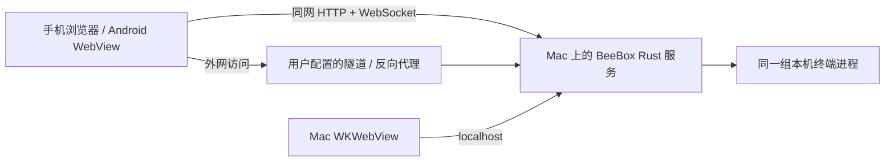

# BeeBox 远程连接参考

核对日期：2026-10-23。参考版本：[bob-agentic/beebox，149565a](https://github.com/bob-agentic/beebox/tree/149565aab3a52942448299c747133a19617549b8)。参考分析阶段只读源码，没有运行参考项目。随后用户授权借鉴交互、范围权限与实时同步，已按 TheAll 的原有协议实现。

## 核心结论

BeeBox 在电脑上运行 Web 服务，手机通过网页或 Android WebView 访问同一服务。它负责共享链接、权限和实时终端同步；公网可达性由用户提供的隧道、反向代理等解决，没有内置 NAT 穿透或中继。[README](https://github.com/bob-agentic/beebox/blob/149565aab3a52942448299c747133a19617549b8/README.md#L95-L109)

## 实现细节

- **服务与地址**：Rust + axum，默认监听 `0.0.0.0:17788`；Mac 壳启动子进程并加载 localhost 网页。默认拒绝非回环请求，开启 Web Server 后放行；分享对话框列出网卡 IPv4 地址，另外保留当前网页的非回环 origin。这里的地址枚举不会验证手机是否真的能够访问。[main.rs](https://github.com/bob-agentic/beebox/blob/149565aab3a52942448299c747133a19617549b8/core/src/main.rs#L19-L24)、[http.rs](https://github.com/bob-agentic/beebox/blob/149565aab3a52942448299c747133a19617549b8/core/src/http.rs#L104-L121)、[ShareDialog.svelte](https://github.com/bob-agentic/beebox/blob/149565aab3a52942448299c747133a19617549b8/ui/src/lib/components/ShareDialog.svelte#L78-L97)
- **配对与权限**：链接 token 关联 All / Workspace / Tab / Pane 范围以及只读/可输入标记。浏览器生成随机 device secret 并保存在 localStorage；第一次 WebSocket 连接把它的 SHA-256 绑定到链接，后续需同时提交链接 token 和相同 secret。这是浏览器凭据绑定，不是硬件身份认证。[state.svelte.ts](https://github.com/bob-agentic/beebox/blob/149565aab3a52942448299c747133a19617549b8/ui/src/lib/state.svelte.ts#L37-L56)、[http.rs](https://github.com/bob-agentic/beebox/blob/149565aab3a52942448299c747133a19617549b8/core/src/http.rs#L255-L297)、[share.rs](https://github.com/bob-agentic/beebox/blob/149565aab3a52942448299c747133a19617549b8/core/src/share.rs#L51-L111)
- **实时同步**：WebSocket 双向 MessagePack，20 秒心跳，断线后从 0.5 秒到 5 秒退避重连；先获取授权范围内的 workspace 树，再请求终端历史快照、订阅后续 PTY 字节，输出落后时重新同步。它同步的是终端输出，不等于 TheAll 的结构化聊天历史接口。[conn.ts](https://github.com/bob-agentic/beebox/blob/149565aab3a52942448299c747133a19617549b8/ui/src/lib/conn.ts#L1-L77)、[http.rs](https://github.com/bob-agentic/beebox/blob/149565aab3a52942448299c747133a19617549b8/core/src/http.rs#L388-L420)
- **手机形态**：Android 是 Kotlin WebView 壳，加载电脑提供的页面；扫描 `beebox://` 深链后还原为 HTTP URL。iPhone 可使用网页，仓库没有对应 iOS 原生客户端。二维码不提供额外的网络连接能力。[Links.kt](https://github.com/bob-agentic/beebox/blob/149565aab3a52942448299c747133a19617549b8/android/app/src/main/java/com/beebox/android/Links.kt#L18-L47)、[README 目录与路线](https://github.com/bob-agentic/beebox/blob/149565aab3a52942448299c747133a19617549b8/README.md)

## 对 TheAll 的启发

| 项目 | BeeBox | 当前 TheAll |
| --- | --- | --- |
| 局域网 | 默认 HTTP/WS，无证书安装 | HTTPS，需要首次安装并信任本机 CA |
| 外网 | 用户自行提供隧道/代理 | 已实现 Mac 主动 WSS 连接自建中继 |
| 手机 UI | 同一终端网页，Android 外壳 | iOS/Android 共用聊天 PWA |
| 同步 | WebSocket 推送 PTY 数据 | WebSocket 变化通知 + HTTP 结构化历史；断线回退轮询 |
| 授权 | 分享范围 + 只读/可输入 + 浏览器 secret | 一次性配对、独立设备 Cookie、撤销；全部/指定 workspace、只读/可操作 |

BeeBox 免安装证书的直接原因是局域网使用明文 HTTP/WS；Android 也显式允许明文连接。这不能替代加密或解决外网可达性。经 HTTPS 反向代理时，普通网页会选 WSS，但当前 `beebox://` 转换会丢失原始 HTTPS scheme，不宜照搬到 TheAll。[Android 网络配置](https://github.com/bob-agentic/beebox/blob/149565aab3a52942448299c747133a19617549b8/android/app/src/main/res/xml/network_security_config.xml)、[连接协议选择](https://github.com/bob-agentic/beebox/blob/149565aab3a52942448299c747133a19617549b8/ui/src/lib/state.svelte.ts#L126-L150)

BeeBox 的终端回滚缓存保存在内存，进程结束会丢失；SQLite 保存布局与授权，CLI 会话编号另用于恢复。因此重连后的终端重放不能代替 TheAll 已有的磁盘聊天历史。[store.rs](https://github.com/bob-agentic/beebox/blob/149565aab3a52942448299c747133a19617549b8/core/src/store.rs#L1-L6)

TheAll 已借鉴扫码后显示已连接设备的交互、按 workspace 分享和只读权限，以及基于事件的实时同步。实现沿用结构化聊天消息、持久化历史与发送幂等机制，保留断线后的分页补齐和禁止自动重复提交的约束。分享范围限制的是显示和可操作的会话，本身不构成执行命令时的文件系统隔离。

用户此前要求外出可用且不安装额外联网工具，现有自建中继仍符合这个方向。BeeBox 的源码没有提供省略公网入口的另一种方案。TheAll 已采用配对反馈、工作空间范围/只读权限和事件同步；具体行为见 [手机连接指南](mobile-access.md)。
