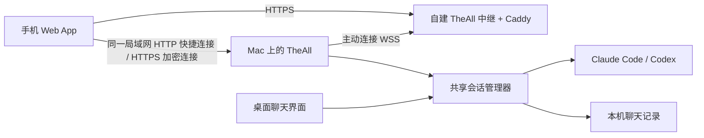

# 手机连接与远程控制

TheAll Mobile 是可添加到主屏幕的 Web App，适用于 iPhone/iPad Safari 与 Android Chrome。Mac 仍运行 Claude Code / Codex 并保存 workspace、聊天历史与 API Key，手机用于查看、回复、新建对话、停止当前任务和回答 AI 的问题。

## 连接设计



局域网和外网中继可以同时开启：同一局域网扫码直接访问 Mac；外出时访问自建中继。局域网快捷连接无需服务器、域名或安装证书。HTTPS 加密模式仍可在高级设置选择。不同地址分别配对，同步同一份聊天。

Mac 主动连接中继，不需要路由器端口转发；手机不需要额外 VPN 或联网工具。每次中继连接用一次性随机挑战和 Mac Ed25519 签名认证，中继固定授权这台 Mac 的公钥。手机再通过 Mac 生成的短期二维码配对，获得独立、可撤销的访问权限。

中继使用 HTTPS/WSS 分段加密，在内存中转发消息，不保存聊天数据库或 API Key。TLS 在中继终止，服务器管理员能够读取经过它的流量，因此应部署在自己控制的服务器上。这一版未实现端到端加密。

## 局域网扫码连接（无需证书）

1. 手机与 Mac 连接同一 Wi-Fi。
2. 点击 Mac 主界面侧边栏底部的 **连接手机**，直接弹出二维码；也可在 **设置 → 手机连接** 中点击 **手机扫码连接**。
3. 用手机相机扫描二维码，打开链接后自动进入工作区和对话。

应用自动开启局域网服务、选择可用地址并生成二维码，不需要另开两个开关、手填地址、设备名、配对码或再次点击连接。新连接优先选择 Wi-Fi/以太网接口；邀请 5 分钟有效且只能使用一次，过期可点击 **重新生成二维码**。已配对的浏览器再次打开同一地址时会恢复登录。

快捷连接使用**未加密的局域网 HTTP**，适合可信的家庭或办公 Wi-Fi。二维码仅在 Mac 上生成，配对权限仍需持有一次性邀请；手机请求继续检查来源、设备授权和共享范围。高级设置提供 HTTPS 加密连接及外网中继。

Debug 地址形如 `http://192.168.1.20:49834`，Release 使用 49833。Mac IP 变化后，快捷连接会重新选择可用地址，旧邀请失效；重新扫码即可。局域网端口只绑定所选私有 IPv4，仅接受私网/回环来源，不监听所有网卡。macOS 如提示本地网络或防火墙权限，仍需允许；访客 Wi-Fi、路由器设备隔离或浏览器严格 HTTPS 模式可能阻止连接。手机切到移动数据后需使用外网中继。

**权限与停止连接：** 展开 **高级连接设置**，可为下一次配对选择全部/指定工作空间和仅查看/查看与操作，也可停用局域网或全部手机访问。二维码旁显示实际授予的权限，修改选项不会改变已生成邀请。已配对设备可随时单独撤销。

快捷连接是在线网页，不提供 Service Worker 离线缓存。可以在浏览器中收藏地址；添加主屏幕快捷方式的可用性取决于浏览器。完整 PWA 安装使用 HTTPS。主屏幕入口若与扫码浏览器不共享 Cookie，需要重新扫码配对。

## 可选：局域网 HTTPS 加密连接

原有已启用 HTTPS 的安装会保留加密模式，直到用户点击 **手机扫码连接** 或在高级设置主动更改模式；已安装的证书和已配对 HTTPS 设备不会被删除。

1. 展开 **高级连接设置 → 局域网直连**，选择 **加密 HTTPS · 需要证书**，开启手机访问和局域网开关，等待 **局域网 HTTPS 已就绪**。选择正确的私有 IPv4。
2. 展开 **首次连接：安装 Mac 证书**，导出 iPhone/iPad 的 `.mobileconfig` 或 Android 的 `.cer`，通过隔空投送、USB 等可信方式传到手机。不要传 `LANIdentity.json`，它含私钥。
3. iPhone/iPad：在「设置 → 通用 → VPN 与设备管理」安装描述文件，再到「设置 → 通用 → 关于本机 → 证书信任设置」，为与 Mac 界面一致的 **TheAll Local …** 开启完全信任。Android：在设置搜索「安装证书」，选择 **CA 证书**安装 `.cer`。
4. 点击高级设置里的 **局域网配对**，扫码打开后自动连接。随后可在 Safari/Chrome 菜单添加到主屏幕。

公开导出文件只有 CA 证书，不含 API Key 或私钥。界面保留证书名称和 SHA-256 指纹；不忽略浏览器证书错误。CA 在重启和更新后保持不变，损坏时拒绝 HTTPS 连接且不覆盖。加密模式保留手选网卡；IP 变化后选择新地址并重新扫码，无需重新安装 CA。HTTP 与 HTTPS 的 Cookie 使用不同名称且分别绑定 origin，切换模式不会覆盖原有 HTTPS 登录。停止使用证书模式后，可在手机系统设置删除对应证书/profile。

## 外网中继首次使用

1. 在 **设置 → 手机连接 → 高级连接设置 → 外网中继 → 设置自己的中继服务** 中复制电脑公钥。该公钥不是 API Key，私钥留在 Mac。
2. 准备可管理的 Linux 服务器和指向它的域名，按 [中继部署说明](../mobile-relay/README.md) 部署 `mobile-relay/`。仓库包含 Docker Compose、Caddy 自动 HTTPS、Node 服务和锁定依赖。
3. 总开关关闭时填写 `https://你的域名`，启用 **外网中继**，再开启总开关。等待显示 **已连接外网中继**；局域网开关可以同时保持开启。
4. 选择本次配对的工作空间范围和操作权限，点击 **外网配对**，手机扫码打开链接后自动连接。使用外网服务的有效 HTTPS 证书，无需安装局域网 CA。
5. 两种入口的地址和 Cookie 不同，需要分别配对；设备列表显示配对地址。撤销一个设备记录不会自动撤销同一手机在另一地址的记录。一次只保留一个尚未使用的邀请，生成新二维码会替换旧二维码。

当前交付没有创建服务器、注册域名或发布公网服务。本机浏览器预览仍可在设置页底部展开使用，HTTP 回环地址只在 Mac 自己的浏览器可用。

## 回合时间与思考强度

新回合结束后，回答底部显示本地完成日期、时间和本回合耗时；这些信息随聊天历史保存。旧历史没有记录过的时间不会补造。失败或手动停止的回合已有回答时，会显示对应状态。

模型选择旁的思考强度用于下一条消息，保留当前对话和草稿。可选值来自当前模型的实际能力，例如 `low`、`medium`、`high`；不同模型的数量可能不同。强度下拉框始终保留在模型选择旁；尚未提供可选强度时置灰，并说明暂不可更改。选择默认强度会恢复该模型的默认设置。 Claude 在每次发送前读取并核对实际设置；被配置限制或无法确认时保留草稿并报错。回答底部的“CLI 已确认强度”来自该回合的设置读回，并随历史保存；Codex 显示“请求强度”。模型在回答中自述的数值不作为配置校验依据，服务端内部预算也不由此字段揭示。

## 手机与手表的任务完成提醒

桌面版可在 Claude Code 或 Codex 的一个回合成功完成后，通过标准 Web Push 向已开启提醒的手机发送通知。手机页面关闭或锁屏时仍可接收；通知显示通用的「任务已完成」，不包含提问、回答、文件路径或工作区名称。点击通知会打开对应对话，读取记录时仍检查当前配对权限。

此功能需要支持 Push API 的浏览器、安全的 HTTPS 连接，以及手机和电脑都能访问系统推送服务。**普通 HTTP 扫码快捷连接不支持后台通知。** 可以使用上文的局域网 HTTPS 或已部署的 HTTPS 外网中继；Web Push 由电脑直接发到手机系统的推送服务，不增加一个需要自行部署的通知服务器。局域网地址离开该网络后可能打不开，即使系统已经收到提醒；外出查看对话请使用中继地址。

### iPhone 与 Apple Watch

1. 使用 Safari 打开 TheAll 的 HTTPS 配对地址，完成配对后选择 **共享 → 添加到主屏幕**，然后从主屏幕打开 TheAll。
2. 在手机页面的 **任务完成提醒** 中开启通知，并在 iOS 的系统提示中选择允许。需要 iOS/iPadOS 16.4 或更新版本；拒绝过权限时，请从系统通知设置重新开启。
3. 发送一条测试通知。佩戴并解锁配对的 Apple Watch，在 iPhone 的 Watch App 通知设置中允许 TheAll 的提醒。

Apple 明确支持主屏幕 Web App 的推送显示在锁屏、通知中心和配对的 Apple Watch 上。默认情况下，iPhone 解锁时通知到手机，锁屏或休眠时通常转到已解锁的手表；它们不保证同时响铃，专注模式和通知设置也会影响呈现。[WebKit Web Push 说明](https://webkit.org/blog/13878/web-push-for-web-apps-on-ios-and-ipados/)、[Apple 通知路由](https://support.apple.com/en-za/108274)。

### Android 与 Wear OS / Galaxy Watch

使用支持 Web Push 的浏览器打开 HTTPS 配对地址，可添加到主屏幕，然后在 TheAll 页面开启任务完成提醒并允许系统通知。在手表的配套 App 中启用对应浏览器/Web App 的通知转发，再发送测试通知。手表通过手机系统通知接收提醒，不需要在手表上打开 TheAll 网页。不同厂商的转发设置、节电和免打扰行为会有区别。[Wear OS 通知说明](https://support.google.com/wearos/answer/6090188?hl=en)。

### 提醒范围与关闭

每个配对设备单独开启、关闭和测试。仅查看设备也可以开启自己有权查看的工作区提醒；订阅不增加操作权限。成功完成只提醒一次，初始化、恢复旧记录、重复完成事件、失败或手动中断不产生完成通知。电脑必须保持运行并联网；系统可能延迟通知，不能作为实时送达保证。

取消订阅、手机退出登录、撤销设备、关闭相应手机连接，都会阻止后续投递；已被系统推送服务接受的消息无法保证撤回。推送订阅的地址、浏览器密钥和本机 VAPID 身份只用于通知，不使用或发送 AI API Key。浏览器/系统清除网站数据后需重新开启提醒。

实机验收包括：两种平台各发送测试通知和一个真实成功回合，锁屏/关闭页面后接收，点击回到正确对话，失败/中断不提醒，以及撤销设备后不再发送。当前代码测试不替代 Apple Watch / Wear OS 真机验收。

## 建议测试顺序

- 手机查看所有 workspace 和旧对话，加载更早的记录。
- 手机发送一条只读提问，确认桌面同步显示；Mac 未发送草稿应保留。
- 手机新建对话、停止运行中的任务、回答 AI 的问题。
- 同时启用两种入口，分别配对。关闭局域网直连后，中继仍可用；关闭外网中继后，局域网仍可用。
- 关闭手机 Wi-Fi，切换到外网地址测试移动数据访问。Mac 睡眠时应显示离线，唤醒后恢复连接，不自动重发之前的消息。

## 支持的操作

| 手机操作 | 电脑端行为 |
| --- | --- |
| 查看工作区和对话 | 遍历所有 workspace、tab 和分割窗格；不局限于当前可见 workspace |
| 查看全部历史 | 默认加载最新 100 条；可以继续向前分页；浏览历史不启动闲置 CLI |
| 继续已有对话 | 按需恢复原后端会话，手机与桌面共用一个运行实例 |
| 新建对话 | 选择已有 workspace 或新 workspace，选择 Claude/OpenAI 和电脑端目录，使用电脑保存的连接 |
| 切换模型 | 下拉选择，下一条手机消息生效；Default 也可切回，不修改桌面草稿 |
| 停止 / 回答问题 | 操作同一个后端当前回合和待回答问题；已过期的问题拒绝重复回答 |
| 撤销手机 | 电脑设置立即撤销设备后续访问；不会回滚已经执行的任务 |

手机草稿和已加载记录只在当前页面内存中保存，不写入浏览器持久化存储。刷新或关闭手机页面会丢失未发送草稿；已提交的聊天保存在 Mac。HTTPS 模式的 Service Worker 只缓存公开页面与图标；HTTP 快捷连接不注册 Service Worker。离线不能发送或排队执行操作。

TheAll 必须保持运行。开启手机访问会避免系统因闲置自动睡眠，但不会阻止合盖或用户主动睡眠。关闭单个桌面窗口不会结束共享会话；完全退出应用、关闭电脑或睡眠会断开手机。自动重连只恢复连接，不自动重放消息。已配对手机首次打开时若 Mac 离线，会自动重试会话探测；Mac 恢复后无需重新配对。

手机配对成功后，Mac 会显示设备名称、授权范围和连接状态。仅查看设备可读历史，不能发消息、回答问题、停止任务或新建对话；指定工作空间的设备只看到该空间，具备操作权限时只能在其中新建对话。更改设置中的选项只影响下一次配对；要改变旧设备权限，撤销后重新配对。旧版本配对设备保留原有全部可操作权限。

手机执行沿用电脑现有 AI 权限模式，包括已配置的自动工具执行。工作空间范围限制的是可访问会话，不是运行命令的文件系统沙盒。API Key 从不发送到手机。协议中的真实用户问题仍需要回答。

## 重试与并发

每次修改请求固定一个随机 `requestId` 和当前 Mac 运行实例的 `bootID`。相同请求重试返回已记录结果，改变内容却复用 ID 会被拒绝。Mac 重启后旧 bootID 失效，避免旧网络请求重新执行。结果未知时先检查对话，然后显式重试同一请求，不会自动重发。模型明确拒绝或写入失败会保留草稿并允许修改；已写出的 Codex 请求若丢失确认，会保持“结果未知”，不会当成明确失败生成新请求。确认过对话后，也可选择取消这次重试。

电脑与手机同时提交时，由共享会话检查运行状态，忙碌时拒绝新的提交。手机消息使用独立的发送入口，保留桌面未发送草稿；Claude 等实际写入和模型确认、Codex 等回合启动确认后，手机才清空已提交草稿。

## 存储和边界

- `Application Support/<bundle ID>/ChatHistory/`：现有聊天历史，文件权限 0600。
- `Application Support/<bundle ID>/MobileAccess/devices.json`：设备名称、token 的 SHA-256 摘要和过期时间；不保存原 token。设备默认 30 天过期。
- `Application Support/<bundle ID>/MobileAccess/relay-identity.key`：本机生成的 Ed25519 私钥，目录 0700、文件 0600。请保留；更换身份需要更新服务器授权公钥。该文件不包含 AI API Key。
- `Application Support/<bundle ID>/MobileAccess/LANIdentity.json`：本机 P-256 CA 私钥与证书，目录 0700、文件 0600，原子排他创建；不使用登录 Keychain。服务证书仅存内存，含所选 IP SAN，有效期最多 90 天，持续运行时提前轮换叶证书，CA 不变。
- 手机授权 Cookie：快捷连接使用 `TheAllLANSession`，HTTPS/预览/中继保留 `TheAllMobileSession`。均为 HttpOnly、SameSite=Strict，HTTPS 下额外使用 Secure；设备凭据绑定配对 origin。更换公网域名或局域网 IP 后需重新配对。
- 服务默认关闭。预览 HTTP 仅绑定 `127.0.0.1`，Debug 49832、Release 49831。局域网 HTTP 快捷连接或 HTTPS 加密连接绑定所选私有 IPv4，Debug 49834、Release 49833，不监听所有网卡。两个网络入口可独立关闭，地址失效或 LAN 监听失败不关闭中继。
- Strict Host/Origin、JSON 和自定义请求头检查；正文、响应、并发和超时均有上限。一个中继部署连接一台 Mac，多个手机可分别配对。
- 只提供原生聊天历史和操作接口，不开放任意本机文件下载或 shell HTTP 接口。

## 实现与测试

Mac：`MobileAccessController`、`MobileHTTPServer`、`MobilePairingStore`、`MobileChatAPI`、`MobileRelayClient`、`MobileLANAddress`、`MobileLANIdentity`；运行会话：`AIChatSessionRegistry` / `TheAllRuntime`；手机：`TheAll/Mobile/MobileWeb.bundle/`；中继：`mobile-relay/`。

```sh
node --test mobile-tests/mobile-web.test.mjs
node mobile-tests/browser-smoke.mjs
cd mobile-relay
npm ci --ignore-scripts
npm test
```

Xcode 的 `MobileAccessTests` 验证配对/撤销、请求校验、共享会话、桌面草稿、历史分页、幂等和真实 Swift WSS → Node 中继 → HTTP 请求链路。真实链路测试需要先安装 `mobile-relay` 的锁定依赖，使用临时身份与模拟 AI 传输，不读取真实 API Key 或发送真实 AI 请求。

`MobileLANIdentityTests` 验证证书链、IP SAN、有效期、内存身份、原子身份持久化和公开导出。`MobileLANTests` 使用真实 HTTP、TLS 和 Node 中继验证快捷扫码、独立 Cookie、单次邀请、共享范围、撤销、监听限制与独立生命周期；TLS 测试只信任自己的临时 CA，不跳过证书验证。网页测试包含真正私网 HTTP 的非 secure context，覆盖 UUID 安全随机回退、扫码自动配对、照片和会话操作。

自动检查覆盖浏览器手机尺寸和中继协议。正式服务器的 DNS/HTTPS 证书、iOS/Android 主屏幕安装、手机移动网络和系统合盖恢复仍需部署后真机验收。

参考：[Apple 手动证书信任](https://support.apple.com/102390)、[Android 证书安装](https://support.google.com/pixelphone/answer/2844832)、[Apple 主屏幕 Web App](https://support.apple.com/guide/iphone/iphea86e5236/ios)、[Web App 安装](https://web.dev/learn/pwa/installation)、[Caddy 自动 HTTPS](https://caddyserver.com/docs/automatic-https)。

## 实时更新与语言

手机通过同源 WebSocket `/api/events` 接收变化通知，再读取最新授权记录。正常连接时不再每秒轮询；网络中断会回退读取，并自动尝试恢复实时连接。恢复连接会补齐状态，保留草稿和已加载历史，不自动重发消息。Mac 设备列表中的“已连接 · 实时同步”表示当前存在事件连接；“已配对 · 当前未连接”仍保留配对权限。

桌面：**设置 → 外观 → 语言**，选择跟随系统、中文（简体）、English、Français、日本語或한국어。选择立即生效并保存。手机登录页和主界面均有语言下拉框，支持同样的五种语言；手机语言独立保存，切换时不清除未发送草稿。

## 发送和查看照片

手机聊天输入框的照片按钮可选择最多 4 张图片，发送前可预览或移除，也可不输入文字直接发送。手机浏览器将每张处理为不超过 512 KiB 的 JPEG（最长边 2048），Mac 再次校验后保存。浏览器无法解码的照片需先转换为 JPEG/PNG。草稿附件仅在当前浏览器会话内、按对话分别保留；网络重试使用原请求，不自动重发。

历史只返回附件名称/尺寸/UUID，图片通过 `/api/chats/<chatID>/images/<imageID>` 单独读取。接口验证配对、工作区范围和照片确实属于该聊天；没有任意文件下载能力。照片响应与 Service Worker 均不缓存私人图片。只读设备可以查看授权历史，不能上传发送。

含照片的请求上限为 3 MiB；使用外网中继时，Mac 与中继需同时更新到支持照片的代码，以匹配上传限额。Mac 原有文本及照片草稿不受手机发送影响。
