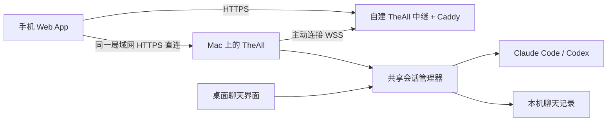

# 手机连接与远程控制

TheAll Mobile 是可添加到主屏幕的 Web App，适用于 iPhone/iPad Safari 与 Android Chrome。Mac 仍运行 Claude Code / Codex 并保存 workspace、聊天历史与 API Key，手机用于查看、回复、新建对话、停止当前任务和回答 AI 的问题。

## 连接设计



两种模式可以同时开启：同一局域网直接访问 Mac；外出时访问自建中继。局域网无需购买服务器或域名，首次需要在手机安装并信任 Mac 的公开 CA 证书。两种地址分别配对，同步同一份聊天。

Mac 主动连接中继，不需要路由器端口转发；手机不需要额外 VPN 或联网工具。每次中继连接用一次性随机挑战和 Mac Ed25519 签名认证，中继固定授权这台 Mac 的公钥。手机再通过 Mac 生成的短期二维码配对，获得独立、可撤销的访问权限。

中继使用 HTTPS/WSS 分段加密，在内存中转发消息，不保存聊天数据库或 API Key。TLS 在中继终止，服务器管理员能够读取经过它的流量，因此应部署在自己控制的服务器上。这一版未实现端到端加密。

## 局域网首次使用（无需服务器）

1. 打开新的 TheAll 本地构建，进入 **设置 → 手机连接**，开启总开关和 **局域网直连**。如果 macOS 询问本地网络或防火墙访问权限，允许 TheAll 接收局域网连接。
2. 手机与 Mac 接入同一 Wi-Fi，或能够互访的同一局域网。选择 Mac 的当前私有 IPv4，等到显示 **局域网 HTTPS 已就绪**。Debug 地址形如 `https://192.168.1.20:49834`；Release 使用 49833。公网地址可以留空。
3. 展开 **首次连接：安装 Mac 证书**。iPhone/iPad 选择 **导出 iPhone / iPad 安装文件**，Android 选择 **导出 Android CA 证书**。通过隔空投送、USB 或自己信任的文件传输方式把文件发到手机。不要传 `LANIdentity.json`，它含私钥。
4. iPhone/iPad：在「设置 → 通用 → VPN 与设备管理」安装收到的 `.mobileconfig`，再到「设置 → 通用 → 关于本机 → 证书信任设置」，为与 Mac 界面名称一致的 **TheAll Local …** 开启完全信任。安装描述文件本身不会自动开启 HTTPS 信任。
5. Android：在系统设置搜索「安装证书」，选择 **CA 证书**并安装 `.cer` 文件；不要选 Wi-Fi 或客户端证书。品牌菜单名称可能不同。
6. 回到 Mac，在 **为此设备设置权限** 选择全部/指定工作空间及仅查看/查看与操作，再点击 **局域网配对**；手机用 Safari/Chrome 扫描新二维码，点击连接 Mac。邀请 5 分钟有效且只能使用一次。如果安装证书时已过期，重新生成二维码。
7. iOS 在 Safari 分享菜单中选择添加到主屏幕；Android 在 Chrome 菜单中选择安装应用 / 添加到主屏幕。独立 Web App 若没有浏览器 Cookie，重新生成邀请配对一次。

公开导出文件只有 CA 证书，既不含 AI API Key，也不含私钥；安装后手机会信任这台 Mac 签发的证书，所以只安装自己 Mac 导出的文件。应用显示证书名称和 SHA-256 指纹供核对，不通过忽略浏览器证书错误来连接。停止使用时，可在手机系统设置删除该证书/profile。

CA 在重启和应用更新后保持不变；私钥文件损坏时拒绝连接且不覆盖。Mac 的 IP 改变后，选择新地址，重新扫描配对（并更新主屏幕入口），无需重新安装 CA。可在路由器为 Mac 保留固定 DHCP 地址。应用不会自动改用另一网卡。

访客 Wi-Fi、设备隔离或 macOS 防火墙可能阻止直连。局域网入口只接受私有 IPv4/回环来源；手机切到移动数据后使用外网中继地址，不能继续访问局域网 IP。

## 外网中继首次使用

1. 在 **设置 → 手机连接 → 外网中继 → 设置自己的中继服务** 中复制电脑公钥。该公钥不是 API Key，私钥留在 Mac。
2. 准备可管理的 Linux 服务器和指向它的域名，按 [中继部署说明](../mobile-relay/README.md) 部署 `mobile-relay/`。仓库包含 Docker Compose、Caddy 自动 HTTPS、Node 服务和锁定依赖。
3. 总开关关闭时填写 `https://你的域名`，启用 **外网中继**，再开启总开关。等待显示 **已连接外网中继**；局域网开关可以同时保持开启。
4. 选择本次配对的工作空间范围和操作权限，点击 **外网配对**，手机扫描二维码并连接。使用外网服务的有效 HTTPS 证书，无需安装局域网 CA。
5. 两种入口的地址和 Cookie 不同，需要分别配对；设备列表显示配对地址。撤销一个设备记录不会自动撤销同一手机在另一地址的记录。一次只保留一个尚未使用的邀请，生成新二维码会替换旧二维码。

当前交付没有创建服务器、注册域名或发布公网服务。本机浏览器预览仍可在设置页底部展开使用，HTTP 回环地址只在 Mac 自己的浏览器可用。

## 建议测试顺序

- 手机查看所有 workspace 和旧对话，加载更早的记录。
- 手机发送一条只读提问，确认桌面同步显示；Mac 未发送草稿应保留。
- 手机新建对话、停止运行中的任务、回答 AI 的问题。
- 同时启用两种入口，分别配对。关闭局域网直连后，中继仍可用；关闭外网中继后，局域网仍可用。
- 关闭手机 Wi-Fi，切换到外网地址测试移动数据访问。Mac 睡眠时应显示离线，唤醒后恢复连接，不自动重发之前的消息。

## 支持的操作

| 手机操作 | 电脑端行为 |
| --- | --- |
| 查看工作区和对话 | 遍历所有 workspace、tab 和分割窗格；不局限于当前可见 workspace |
| 查看全部历史 | 默认加载最新 100 条；可以继续向前分页；浏览历史不启动闲置 CLI |
| 继续已有对话 | 按需恢复原后端会话，手机与桌面共用一个运行实例 |
| 新建对话 | 选择已有 workspace 或新 workspace，选择 Claude/OpenAI 和电脑端目录，使用电脑保存的连接 |
| 切换模型 | 下拉选择，下一条手机消息生效；Default 也可切回，不修改桌面草稿 |
| 停止 / 回答问题 | 操作同一个后端当前回合和待回答问题；已过期的问题拒绝重复回答 |
| 撤销手机 | 电脑设置立即撤销设备后续访问；不会回滚已经执行的任务 |

手机草稿和已加载记录只在当前页面内存中保存，不写入浏览器持久化存储。刷新或关闭手机页面会丢失未发送草稿；已提交的聊天保存在 Mac。Service Worker 只缓存公开的页面与图标，离线不能发送或排队执行操作。

TheAll 必须保持运行。开启手机访问会避免系统因闲置自动睡眠，但不会阻止合盖或用户主动睡眠。关闭单个桌面窗口不会结束共享会话；完全退出应用、关闭电脑或睡眠会断开手机。自动重连只恢复连接，不自动重放消息。已配对手机首次打开时若 Mac 离线，会自动重试会话探测；Mac 恢复后无需重新配对。

手机配对成功后，Mac 会显示设备名称、授权范围和连接状态。仅查看设备可读历史，不能发消息、回答问题、停止任务或新建对话；指定工作空间的设备只看到该空间，具备操作权限时只能在其中新建对话。更改设置中的选项只影响下一次配对；要改变旧设备权限，撤销后重新配对。旧版本配对设备保留原有全部可操作权限。

手机执行沿用电脑现有 AI 权限模式，包括已配置的自动工具执行。工作空间范围限制的是可访问会话，不是运行命令的文件系统沙盒。API Key 从不发送到手机。协议中的真实用户问题仍需要回答。

## 重试与并发

每次修改请求固定一个随机 `requestId` 和当前 Mac 运行实例的 `bootID`。相同请求重试返回已记录结果，改变内容却复用 ID 会被拒绝。Mac 重启后旧 bootID 失效，避免旧网络请求重新执行。结果未知时先检查对话，然后显式重试同一请求，不会自动重发。模型明确拒绝或写入失败会保留草稿并允许修改；已写出的 Codex 请求若丢失确认，会保持“结果未知”，不会当成明确失败生成新请求。确认过对话后，也可选择取消这次重试。

电脑与手机同时提交时，由共享会话检查运行状态，忙碌时拒绝新的提交。手机消息使用独立的发送入口，保留桌面未发送草稿；Claude 等实际写入和模型确认、Codex 等回合启动确认后，手机才清空已提交草稿。

## 存储和边界

- `Application Support/<bundle ID>/ChatHistory/`：现有聊天历史，文件权限 0600。
- `Application Support/<bundle ID>/MobileAccess/devices.json`：设备名称、token 的 SHA-256 摘要和过期时间；不保存原 token。设备默认 30 天过期。
- `Application Support/<bundle ID>/MobileAccess/relay-identity.key`：本机生成的 Ed25519 私钥，目录 0700、文件 0600。请保留；更换身份需要更新服务器授权公钥。该文件不包含 AI API Key。
- `Application Support/<bundle ID>/MobileAccess/LANIdentity.json`：本机 P-256 CA 私钥与证书，目录 0700、文件 0600，原子排他创建；不使用登录 Keychain。服务证书仅存内存，含所选 IP SAN，有效期最多 90 天，持续运行时提前轮换叶证书，CA 不变。
- 手机授权 Cookie：HttpOnly、HTTPS 下 Secure、SameSite=Strict；设备凭据绑定配对 origin。更换公网域名或局域网 IP 后需重新配对。
- 服务默认关闭。预览 HTTP 仅绑定 `127.0.0.1`，Debug 49832、Release 49831。局域网 HTTPS 绑定所选私有 IPv4，Debug 49834、Release 49833，不监听所有网卡。两个网络入口可独立关闭，地址失效或 LAN 监听失败不关闭中继。
- Strict Host/Origin、JSON 和自定义请求头检查；正文、响应、并发和超时均有上限。一个中继部署连接一台 Mac，多个手机可分别配对。
- 只提供原生聊天历史和操作接口，不开放任意本机文件下载或 shell HTTP 接口。

## 实现与测试

Mac：`MobileAccessController`、`MobileHTTPServer`、`MobilePairingStore`、`MobileChatAPI`、`MobileRelayClient`、`MobileLANAddress`、`MobileLANIdentity`；运行会话：`AIChatSessionRegistry` / `TheAllRuntime`；手机：`TheAll/Mobile/MobileWeb.bundle/`；中继：`mobile-relay/`。

```sh
node --test mobile-tests/mobile-web.test.mjs
node mobile-tests/browser-smoke.mjs
cd mobile-relay
npm ci --ignore-scripts
npm test
```

Xcode 的 `MobileAccessTests` 验证配对/撤销、请求校验、共享会话、桌面草稿、历史分页、幂等和真实 Swift WSS → Node 中继 → HTTP 请求链路。真实链路测试需要先安装 `mobile-relay` 的锁定依赖，使用临时身份与模拟 AI 传输，不读取真实 API Key 或发送真实 AI 请求。

`MobileLANIdentityTests` 验证证书链、IP SAN、有效期、内存身份、原子身份持久化和公开导出。`MobileLANTests` 使用真实 TLS 和 Node 中继验证两种入口、鉴权与独立生命周期；测试只信任自己的临时 CA，不跳过证书验证。

自动检查覆盖浏览器手机尺寸和中继协议。正式服务器的 DNS/HTTPS 证书、iOS/Android 主屏幕安装、手机移动网络和系统合盖恢复仍需部署后真机验收。

参考：[Apple 手动证书信任](https://support.apple.com/102390)、[Android 证书安装](https://support.google.com/pixelphone/answer/2844832)、[Apple 主屏幕 Web App](https://support.apple.com/guide/iphone/iphea86e5236/ios)、[Web App 安装](https://web.dev/learn/pwa/installation)、[Caddy 自动 HTTPS](https://caddyserver.com/docs/automatic-https)。

## 实时更新与语言

手机通过同源 WebSocket `/api/events` 接收变化通知，再读取最新授权记录。正常连接时不再每秒轮询；网络中断会回退读取，并自动尝试恢复实时连接。恢复连接会补齐状态，保留草稿和已加载历史，不自动重发消息。Mac 设备列表中的“已连接 · 实时同步”表示当前存在事件连接；“已配对 · 当前未连接”仍保留配对权限。

桌面：**设置 → 外观 → 语言**，选择跟随系统、中文（简体）、English、Français、日本語或한국어。选择立即生效并保存。手机登录页和主界面均有语言下拉框，支持同样的五种语言；手机语言独立保存，切换时不清除未发送草稿。

## 发送和查看照片

手机聊天输入框的照片按钮可选择最多 4 张图片，发送前可预览或移除，也可不输入文字直接发送。手机浏览器将每张处理为不超过 512 KiB 的 JPEG（最长边 2048），Mac 再次校验后保存。浏览器无法解码的照片需先转换为 JPEG/PNG。草稿附件仅在当前浏览器会话内、按对话分别保留；网络重试使用原请求，不自动重发。

历史只返回附件名称/尺寸/UUID，图片通过 `/api/chats/<chatID>/images/<imageID>` 单独读取。接口验证配对、工作区范围和照片确实属于该聊天；没有任意文件下载能力。照片响应与 Service Worker 均不缓存私人图片。只读设备可以查看授权历史，不能上传发送。

含照片的请求上限为 3 MiB；使用外网中继时，Mac 与中继需同时更新到支持照片的代码，以匹配上传限额。Mac 原有文本及照片草稿不受手机发送影响。
